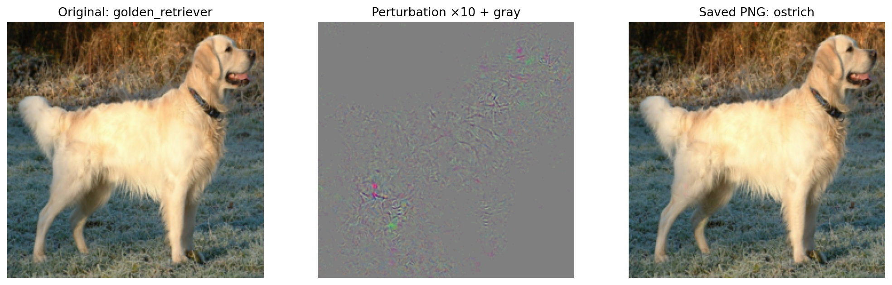

# Adversarial attack — FollowUp 3 (Deep Learning)

Targeted adversarial example generated with box-constrained L-BFGS-B
(Szegedy et al., *Intriguing properties of neural networks*, 2014, §4.1) against a Keras ResNet-50 trained on ImageNet.

| File | ResNet-50 prediction |
|---|---|
| `original.png` | golden_retriever (95.4 %) |
| `adversarial.png` | **ostrich (66.4 %)** |

Perturbation: L2 = 0.888, RMS = 0.0023, L∞ = 10/255 (pixels in [0,1]). Details in `metrics.json`.

Source image: *Golden Retriever Dukedestiny01*, Wikimedia Commons, public domain.

Raw URLs for the Keras.js demo (https://transcranial.github.io/keras-js/#/resnet50):
- https://raw.githubusercontent.com/djaramillop5816/-adversarial-attacks-fu3/main/original.png
- https://raw.githubusercontent.com/djaramillop5816/-adversarial-attacks-fu3/main/adversarial.png
